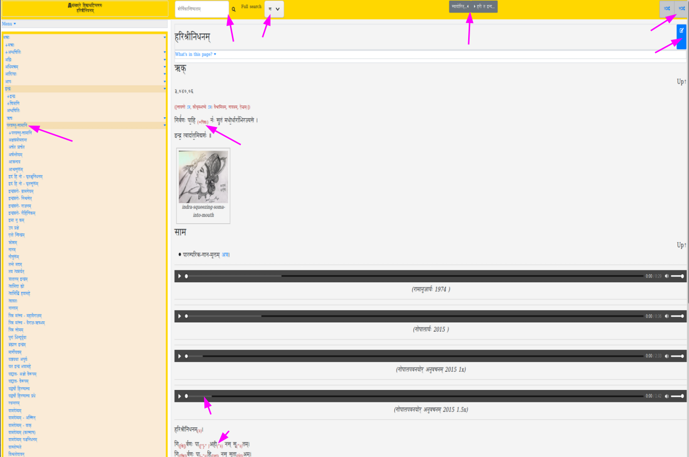

## Intro
A wiki-like theme for managing and presenting your content in Hugo - with special support for Sanskrit/ Indic languages (where mixed case words are common when Roman script is used).

- Full Article [pdf](https://sanskrit-coders.github.io/content/indic-site-framework-2022/indic-site-framework.pdf)


## Features



Some notable things you get with this theme (in decreasing order of interest):

- Navigation
  - Collapsible "accordion" sidebar with automated directory listing.
  - Collapsible "accordion" table-of-contents for each page.
  - "Next and Previous" page navigation buttons.
- Search
  - JSON based title/ url search
  - Search engine optimization markup and indices - which you would use with various search engines.
  - Local content pagefind-based search UI. (Can be overridden by another identically named file.)
- Reading
  - A layout which automatically adjusts to the user's screen size.
  - Embedding audio and video items. Ability to sequentially play audio tracks within a page.
  - Special formatting consideration for fonts which need to be displayed bigger (eg: Devanagari for sanskrit.)
  - Transliteration dropdown: scripts ranging from devanāgarī to grantha, brāhmī to ISO-15919.
  - Text to speech interface (under development).
  - Disqus for comments (optional).
  - Collapsible detail sections.
- Content management
  - "Edit me" links.
  - Basic ability to include contents from another page using the same theme within another.
  - Inline annotation
  - Version control when backed by a GitHub-type online repository.
  - Support for optionally enabling MathML. [^mathml_note]
- Portability: We try to minimize the use of any specific templating language in favor of accomplishing stuff (menus, tables of contents, page inclusions) with javascript. This makes it a bit easier to move to another static website generator like hugo in the future.


[^mathml_note]: See layouts/partials/mathjax_tex_commands.html for useful tex shortcuts, and layouts/partials/head_js.html for configuration.

## Example sites

- [kirITa-kITAShTottara-shata-nAmAvalI](https://vishvAsa.github.io/kAvyam/laxyam/padyam/rAjArAmasuta-shankaraH/stotram/kirITa-kITAShTottara-shata-nAmAvalI/)
- https://vishvAsa.github.io/notes/
- https://sanskrit-coders.github.io/
- https://sanskrit.github.io/


## Usage
### Recommendations about config.toml
#### Recommended settings
disablePathToLower = true Since we assume mixed case to have special meaning.

#### canonifyURLs
canonifyURLs = True won't work well as of 20190304. .URL variable does will then not include the subdirectory portion of the basepath (ie kAvyam/ bit in http://localhost:1313/kAvyam/), leading to urls like http://localhost:1313/XYZ/padya/kAlidAsa/raghuvaMsha/01/ instead of  http://localhost:1313/kAvyam/XYZ/padya/kAlidAsa/raghuvaMsha/01/.

#### Optional js modules
Some js modules are automatically included.  
See webpack_src/package.json for a list of those (should be invoked in some webpack_src/js script to be bundled in static/webpack_dist/uiLib-bundle.js ).

See layouts/partials/head_js.html for optional js modules and the config parameters controlling them. 

### Search
By default pagefind is used.

You can index a site by doing:

```bash
hugo
npx pagefind --site build_github --output-path build_github/pagefind
```

The provided /search url path will have a content-esarch UI.

### Dynamic Content Includes & Media Embeds

#### Page / Markdown Includes (`<div class="js_include" ...> </div>`)
Implemented in `webpack_src/js/handleIncludes.js` and `webpack_src/js/mdInclude.js`.

- **Class**: `js_include` (add `collapsed` to render initially collapsed inside `<details>` and lazy-load only when opened).
- **Attributes**:
  - `url` (required): Relative or root-relative URL of an HTML page (trailing `/` or `.html`) or Markdown `.md` file (including raw GitHub `.md` URLs). Relative `src`, nested `js_include` URLs, heading levels, and element/footnote IDs inside included content are automatically relativized.
  - `newLevelForH1` (optional; default in editor snippets: `"5"`): Target heading level (`"1"`–`"6"`) to shift included `<h1>` elements to (deeper headings shift proportionally, clamped at `<h6>`), or `"b[]"` to convert headings to `<b>[...]</b><br>`.
  - `includeTitle` (optional; default in editor snippets: `"false"`): Controls displaying the included page title: `"true"` (heading), `"plain"` (`<span>`), or `"false"` (hidden; overrides `title`). If omitted, falls back to `title`.
  - `title` (optional): Explicit title string (overrides the target page's `<h1>` / frontmatter `title` unless `includeTitle="false"`).
  - `detailsPattern` (optional; default: `".*"`): Regex matched against `<summary>` text (trimmed) so only matching `<details>` blocks are included. When `".*"` (or omitted), the entire content is included. When set to another pattern, matching outer `<details>` keep their full subtree, and non-matching `<details>` recurse into child `<details>`.
  - `unfilled` (optional marker): Set/removed automatically during filling (`handleIncludes()` forces `unfilled` before loading).
  - `.md`-only frontmatter attributes:
    - `fieldNames` (optional): Comma-separated YAML/TOML frontmatter keys prepended as `key : value` lines.
    - `metadataDetailName` (optional; default in snippets: `"false"`): When set to anything other than `"false"`, prepends a `<details><summary>...</summary>` block of frontmatter metadata (an empty `""` attribute defaults the summary to `"Metadata"`).
- **URL query parameters**:
  - `includeStyle`: Set to anything other than `"on"` (the default) to skip dynamic include loading.
  - `expandAll`: `"true"` overrides `collapsed` and expands includes eagerly (default: `"false"`).

#### Spreadsheet Includes (`<div class="spreadsheet" ...> </div>`)
Implemented in `webpack_src/js/spreadsheets.js` and `webpack_src/js/spreadsheetsLazy.js` (Handsontable chunk loaded on demand).

- **Attributes**:
  - `src` (required): Path/URL to a `.json` (array of rows), `.json5`, `.toml` (expects top-level `data` array), `.tsv`, or `.csv` file.
  - `headers` (optional): Comma-separated custom column headers (defaults to keys of the first row).
  - `separator` (optional, for `.tsv`/`.csv`): Column delimiter string (default: `"\t"`; pass `","` for `.csv`).
  - `fullHeightWithRowsPerScreen` (optional): Rows per screen height (`0.8 * screen.availHeight`) to scale container height (`0.8 * screen.availHeight * ceil(rows / N)`).
  - `fullHeight` (optional): Checked/logged in debug output (`fullHeightWithRowsPerScreen` controls computed pixel height).

#### Audio Embeds (`<div class="audioEmbed" ...></div>`)
Implemented in `webpack_src/js/audioEmbed.js`.

- **Attributes**:
  - `src` (required): `.mp3` path/URL with optional query parameters (`autoplay=1|0`, `loop=1|0`, `controls=0|1`; defaults: `autoplay=0`, `loop=0`, `controls=1`). Unrecognized query parameters or non-`.mp3` URLs are rejected.
  - `caption` (optional): Caption rendered below the `<audio>` player as `<div class="audioCaption"> (caption)</div>`.
- **Playback behavior**: Playing one `<audio>` pauses others on the page; when a track finishes, playback advances to and focuses the next `<audio>` (or focuses `#nextPage` after the last track).

#### Video Embeds (`<div class="videoEmbed" ...></div>`)
Implemented in `webpack_src/js/videoEmbed.js`.

- **Attributes**:
  - `src` (required): External `http://` or `https://` YouTube (`youtube.com/watch?v=...`, `youtu.be/...`, `youtube.com/embed/...`) or Vimeo (`vimeo.com/...`) URL. Supports query parameters `autoplay=1` and `loop=1` (YouTube loops also pass `playlist=<id>&version=3`).
  - (`caption` may be included in editor templates for readability, though `videoEmbed.js` only reads `src`.)

## Code Contributions
### JS and CSS
Javascript and css dependencies are mostly managed with npm and webpack.
If you modify javascript (src folder) or add some bundled css, you must rerun webpack. A good workflow for such development:

- Switch to webpack_src directory.
- Clean node_modules if needed.
- Run `npm install`
- Run `npm run watch`